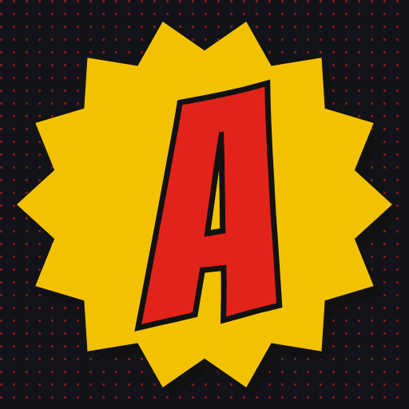
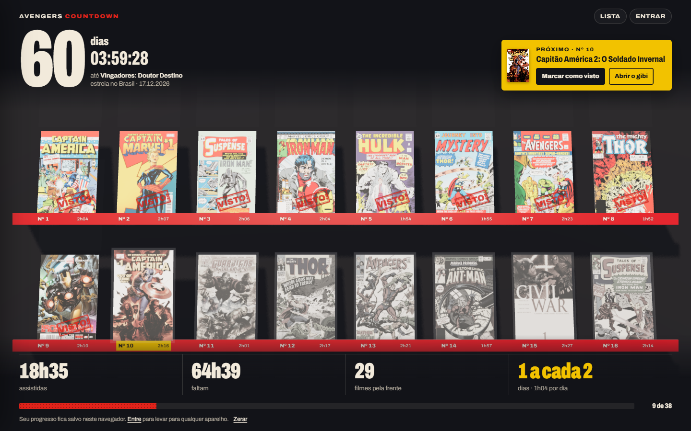
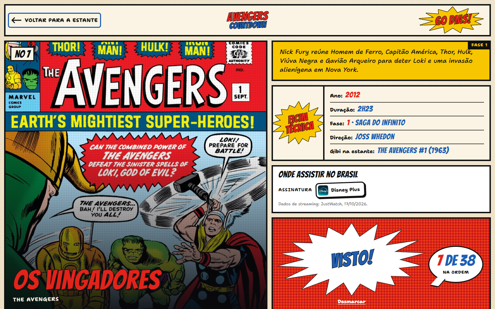
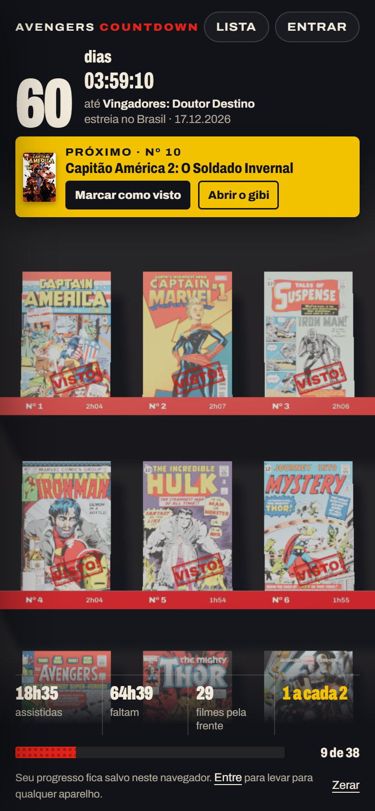
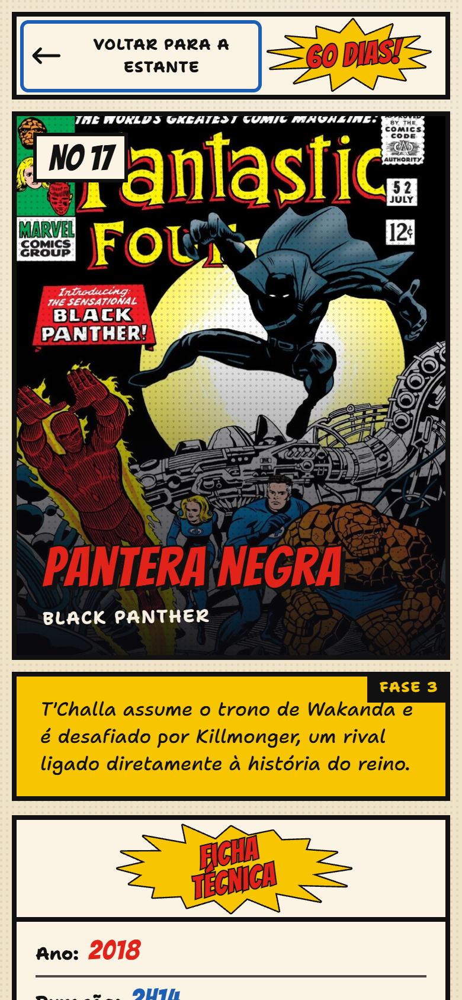
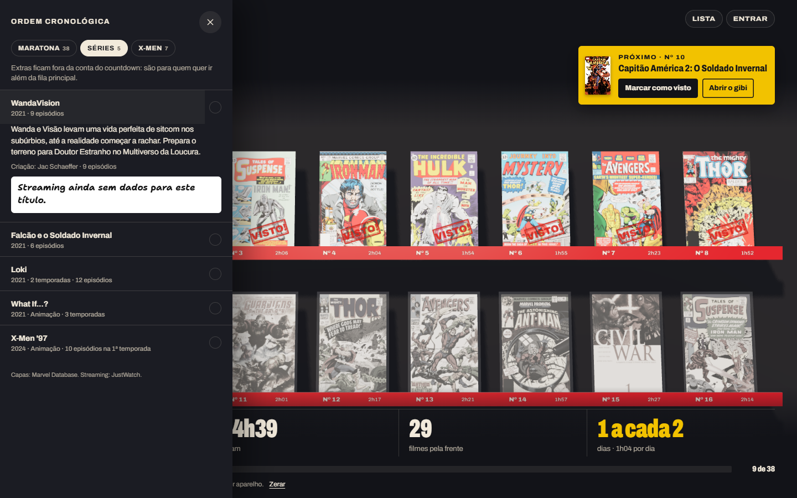

<div align="center">



# Avengers Countdown

**Uma estante de gibis em 3D para maratonar o MCU em ordem cronológica até a estreia de _Vingadores: Doutor Destino_ (17/12/2026 no Brasil).**

[**mcu.avaaraujo.com**](https://mcu.avaaraujo.com)




</div>

## O que é

Cada um dos 38 filmes aparece como a **capa do gibi original que o inspirou**, numa estante de laca vermelha. Os não vistos ficam no saco plástico de colecionador, em preto e branco. Ao marcar um filme, o gibi sai do saco, ganha cor e recebe o carimbo **VISTO!**. O próximo da fila fica puxado para fora da prateleira, e no fim da estante está a edição da estreia, num case graduado com a contagem regressiva na etiqueta.

- **Countdown** até a estreia, com o próximo filme, horas vistas e restantes, ritmo necessário por dia e barra de progresso. Depois da estreia, vira "Em cartaz".
- **Uma página para cada filme**, com link próprio (`/filme/the-avengers`), ficha técnica, sinopse, o gibi de origem e **onde assistir no Brasil** (assinatura, aluguel e compra). O link compartilhado ganha capa e título próprios.
- **Extras**: séries do Disney+ e filmes dos X-Men, numa lista à parte que não entra na conta do countdown.
- **Conta opcional**: sem login o progresso fica no navegador; com link mágico por e-mail (Supabase Auth) ele vai para a conta e aparece em qualquer aparelho.
- **Leve no celular**: texturas menores, sem antialias e sem transmissão de luz, resolução limitada e menos quadros quando nada se mexe.
- Lista em texto acessível, que também serve de alternativa sem WebGL, navegação por teclado (setas e `Esc`) e respeito a `prefers-reduced-motion`.

<table>
  <tr>
    <td width="62%"></td>
    <td width="19%"></td>
    <td width="19%"></td>
  </tr>
  <tr>
    <td align="center"><sub>O detalhe do filme, em formato de página de gibi</sub></td>
    <td align="center" colspan="2"><sub>No celular</sub></td>
  </tr>
</table>



## Rodando

```bash
npm install
cp .env.example .env.local   # preencha NEXT_PUBLIC_SUPABASE_PUBLISHABLE_KEY
npm run dev                  # http://localhost:3000
```

| Variável | Para quê |
|---|---|
| `NEXT_PUBLIC_SUPABASE_URL`, `NEXT_PUBLIC_SUPABASE_PUBLISHABLE_KEY` | Banco e login. A chave publicável é segura no navegador; o acesso é limitado por RLS. |
| `TMDB_API_KEY` | Opcional. Títulos e sinopses em português do Brasil e streaming atualizado todo dia, via [TMDB](https://www.themoviedb.org/). Sem ela valem os dados do banco. |
| `NEXT_PUBLIC_SITE_URL` | Opcional. Origem pública para metadados e imagens de compartilhamento. |

### Login por link mágico

No Supabase, em **Authentication → URL Configuration**, deixe o **Site URL** apontando para o endereço de produção e inclua em **Redirect URLs** o de produção e o local, com curinga (`https://mcu.avaaraujo.com/**` e `http://localhost:3000/**`). Sem isso o link do e-mail cai no endereço errado.

## Como funciona

- **Catálogo**: filmes, extras, a estreia e o streaming vêm do Supabase num `'use cache'` (estático, revalida a cada hora). Quando há `TMDB_API_KEY`, uma segunda camada em cache de um dia sobrepõe os textos em português e a lista de streaming do Brasil, mantendo os preços de aluguel e compra que já estavam no banco.
- **Rotas**: `/` e `/filme/[slug]` renderizam o mesmo app. Abrir e fechar um gibi usa `history.pushState`, então o botão voltar fecha o gibi sem recarregar a estante 3D.
- **Estante**: three.js imperativo em [`ShelfScene.ts`](src/components/shelf/ShelfScene.ts), controlado pelo React por uma API pequena.
- **Progresso**: `localStorage` para visitantes e a tabela `avengers_watches` (RLS, só as próprias linhas) para quem entrou.

## Estrutura

| Caminho | O que é |
|---|---|
| `src/app/page.tsx`, `src/app/filme/[slug]/` | Home e página de cada filme, com metadados e imagem de compartilhamento por filme. |
| `src/components/CountdownApp.tsx` | HUD, lista com extras, painel de conta, estado pós-estreia e a orquestração abrir/fechar do gibi. |
| `src/components/shelf/ShelfScene.ts` | A estante em three.js, com o modo leve para celulares. |
| `src/components/ComicPage.tsx` | A tela de detalhe em formato de página de gibi. |
| `src/components/useProgress.ts` | Progresso local e na conta. |
| `src/lib/catalog.ts`, `src/lib/tmdb.ts` | Catálogo do Supabase e a camada do TMDB. |
| `supabase/migrations/`, `supabase/seed/` | Tabelas `avengers_*` com RLS, os 38 filmes, a estreia e os extras. |
| `scripts/` | `make-thumbs` (capas pequenas), `brand` (ícones e card social), `screenshots` (imagens deste README). |
| `prototype/` | O protótipo em three.js puro que originou o app (`node prototype/serve.mjs`). |
| `PLANO.md`, `PRODUCT.md` | Plano e contexto do produto. |

## Scripts

```bash
npm run thumbs        # gera public/covers/sm a partir das capas
npm run brand         # ícone, favicon e card social (usa o Edge ou Chrome local)
npm run build && npx next start -p 3100
npm run screenshots -- http://localhost:3100   # atualiza docs/images
```

## Créditos e avisos

Projeto de fã, sem afiliação com a Marvel ou a Disney. Capas dos gibis: [Marvel Database](https://marvel.fandom.com/). Dados de streaming: JustWatch, via TMDB. Este produto usa a API do TMDB, mas não é endossado nem certificado por ele.

O código é [MIT](LICENSE). As capas, os nomes e os títulos pertencem aos seus donos e são usados sem fins comerciais.
